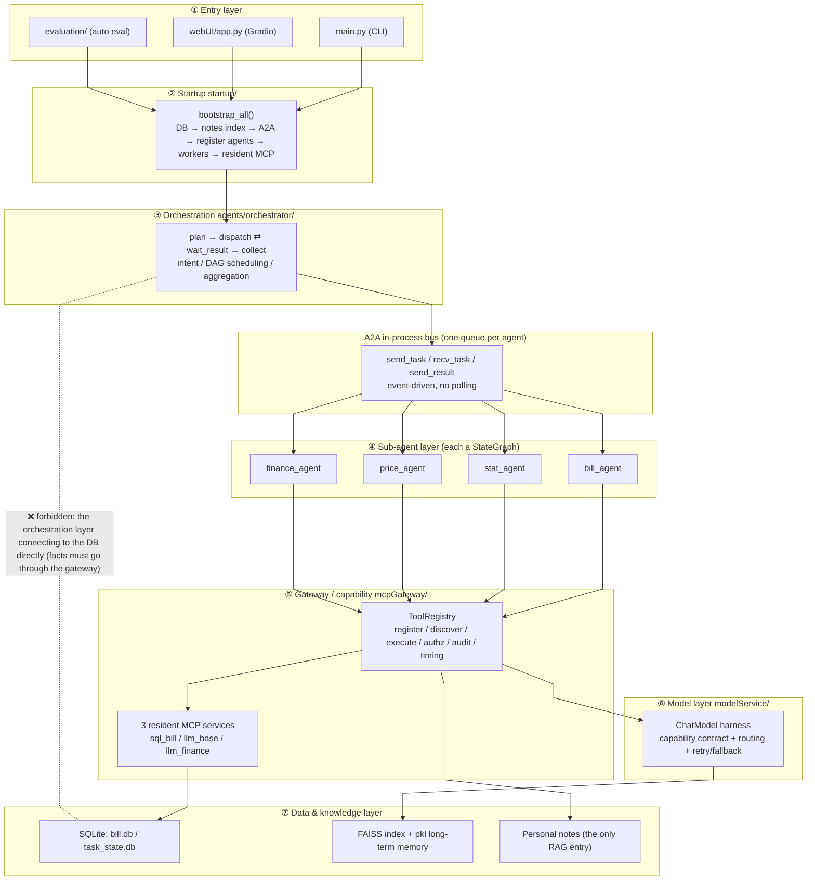
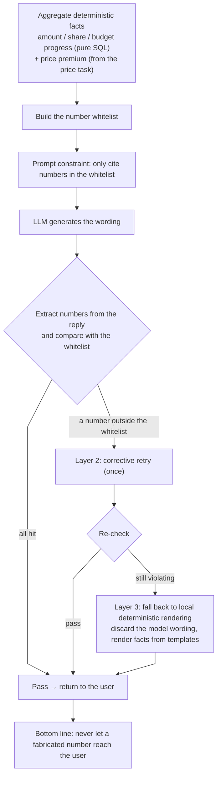
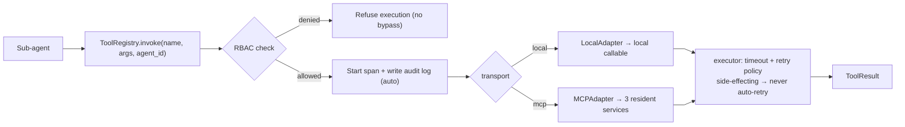
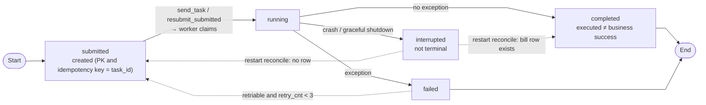
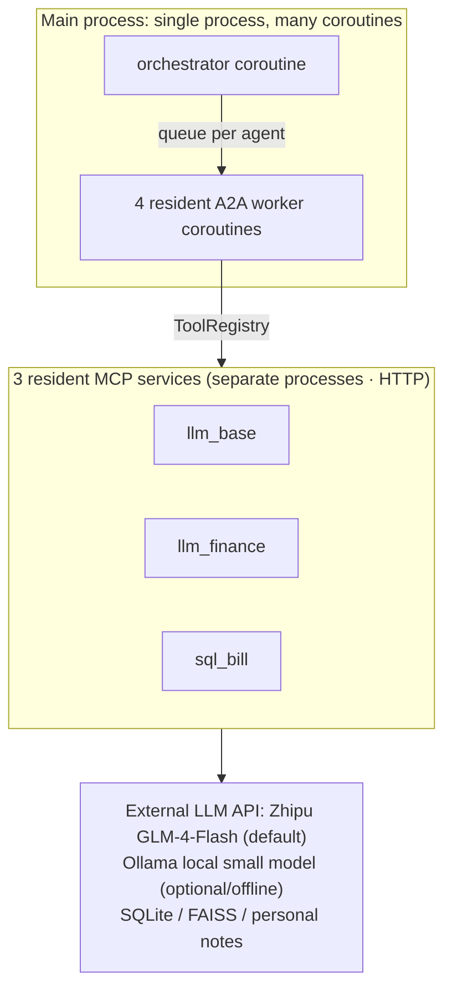

**English** | [中文](README.zh-CN.md)

# billAgent · Multi-Agent Expense Assistant

**Multi-agent orchestration · Pre-spend decisions (budget progress / price comparison) + Post-spend review (spending evaluation / saving tips) · Every number in a reply is computed by SQL · Runs on a single machine**

## The problem: bookkeeping tools fail at the two moments that matter

Most bookkeeping tools are just running ledgers, so they are useless exactly when you need them most:

- **Before spending** — no basis for a decision: how much budget is left this month? Will this purchase push me over? Is this price high or low compared with similar items? These are precisely the references you need to decide *whether to spend this money*.
- **After spending** — a pile of numbers with no evaluation: where did the money go? Which items could I actually cut? Am I doing better or worse than last month? All this *review* work is left to you.

## The approach: multi-agent orchestration + deterministic numerics

Break natural language into executable tasks, hand them to multiple agents, and make **every number come from deterministic computation**:

| Stage | How |
|---|---|
| **Orchestration** | A LangGraph orchestrator + 4 sub-agents (bill / stat / price / finance); each agent is a `StateGraph` — plan by task type, parallel dispatch, aggregate results |
| **Tool access** | A self-built tool-access layer unifies local functions and MCP services: one tool contract, one execution entry, protocol differences contained in the adapter layer |
| **Numeric computation** | Amounts, totals, shares, budget progress and price premiums are **all produced by SQL and numeric code**; the model only handles intent understanding and wording |
| **Anti-hallucination** | Before a reply goes out, every number is checked against a **number whitelist**; on violation it retries with correction, and if that still fails it falls back to deterministic template rendering |
| **Model channel** | An external LLM (OpenAI-compatible, Zhipu GLM-4-Flash by default) is primary; a local Ollama small model is an optional offline / fallback channel — the full flow runs even without an API key |

## The product: a bookkeeping assistant you can actually use

**Say one sentence to record a purchase, check a budget, compare prices, evaluate spending and get saving tips**:

```
Log lunch 56 yuan
How much budget is left this month?
Is a 20-yuan taxi ride expensive?
Give me some saving tips
```

~23k lines of Python plus ~16k lines of tests; runs on a single machine, with both a Web (Gradio) and a CLI entry point. Below is what it actually looks like, what it can do, and how to run it in 30 seconds. To dig into the implementation, start from [Architecture](#6-architecture-for-the-curious).

---

## Table of contents

- [1. What it looks like](#1-what-it-looks-like)
- [2. What it can do](#2-what-it-can-do)
- [3. Run it in 30 seconds](#3-run-it-in-30-seconds)
- [4. Common commands](#4-common-commands)
- [5. Where do these numbers come from](#5-where-do-these-numbers-come-from)
- [6. Architecture (for the curious)](#6-architecture-for-the-curious)
- [7. Five core designs](#7-five-core-designs)
- [8. Measured results](#8-measured-results)
- [9. Directory structure](#9-directory-structure)
- [10. Tests & evaluation](#10-tests--evaluation)
- [11. Tech stack](#11-tech-stack)
- [12. Known limits & roadmap](#12-known-limits--roadmap)

---

## 1. What it looks like

### Web UI (Gradio — open it in a browser)

```
┌────────────────────────────────────────────────────────────────┐
│  Expense Assistant                                 [ Exit ]    │
├────────────────────────────────────────────────────────────────┤
│  ▸ Budget & preferences                            (click)     │
├────────────────────────────────────────────────────────────────┤
│                                                                │
│  You │ Log lunch 56 yuan                                       │
│      │                                                         │
│  AI  │ Logged ✅ "Food · lunch" 56 CNY                         │
│      │ Food this month: X CNY (Z% of the Y monthly budget)     │
│      │ Level: normal                                           │
│      │                                                         │
│  You │ How much did I spend this month?                        │
│      │                                                         │
│  AI  │ This month: X CNY over N entries                        │
│      │ Food X (Z%) · Transport X (Z%) · Shopping X (Z%)        │
│      │ MoM +A%                                                 │
│      │                                                         │
│  You │ Is 20 yuan for a taxi expensive?                        │
│      │                                                         │
│  AI  │ Transport · taxi 20 CNY: local average X CNY, +Z%       │
│      │ Verdict: slightly above the local level                 │
│                                                                │
├────────────────────────────────────────────────────────────────┤
│ [ Want to log one? Just type, e.g. "Log lunch 56" (Enter) ]    │
│                              [ Send ] [ New session ]          │
└────────────────────────────────────────────────────────────────┘
```

The UI has three parts: the **top bar**, **Budget & preferences** (a collapsible panel that writes config directly, bypassing the model), and the **conversation area**.

In the settings panel you can set: city, monthly total budget, spending mode (frugal / normal / loose), per-category budgets (food / transport / lodging / shopping / entertainment), and reminder preferences — saved and effective immediately; later logging and alerts use the new config.

### CLI (`python main.py`)

The same backend, two entry points, switch anytime:

```
===== Expense Assistant started, type exit to quit =====
User: Log lunch 56 yuan
Agent: Logged ✅ "Food · lunch" 56 CNY; food this month X CNY

User: exit
Bye
```

> In the above, `X` / `Y` / `Z` / `A` / `N` are real runtime numbers; only the format is illustrated.

---

## 2. What it can do

**It covers the whole spending loop: a basis for decisions before you spend, and evaluation after.** The entries below are split into "Before you spend / After you spend / Basics & config":

### A. Before you spend — a basis for decisions

| Capability | How you say it | What it does |
|---|---|---|
| **Budget progress** | `How much budget is left this month?` | Combines this month's spend and the monthly budget to give the remaining budget and a level (safe / watch / warn / over) |
| **Price comparison** | `Is a 20-yuan taxi expensive?` / `Is 30 yuan for coffee above market?` | Compares with the city's category average and gives a premium rate (**the amount is required** to form a comparison) |

### B. After you spend — evaluation, review and advice (the thicker half)

| Capability | How you say it | What it does |
|---|---|---|
| **Spending evaluation & financial advice** | `Give me some saving tips` | Combines spending structure, last-3-month habits and personal notes to give **actionable** saving items (not a vague "spend less") |
| **Statistics & review** | `How much did I spend this month?` / `Check July expenses` | Monthly / by-category totals, shares, MoM/YoY — see where the money went and whether you are doing better |
| **Overspending alerts** | No question needed; rule-triggered | A category nearing/over budget → alert; monthly total budget in **four levels** (safe / watch / warn / over) → alert |

### C. Basics & configuration

| Capability | How you say it | What it does |
|---|---|---|
| **Logging** | `Log lunch 56` / `spent 32 on a taxi yesterday` | Extracts amount, category and date, persists them, and distills a spending habit |
| **Edit / delete** | `Change that last one to 60` / `Delete the last one` | Resolves the reference from context, edits, and recomputes this month's stats |
| **Budget & notes** | `Set monthly budget 3000` / `Note: bananas are 8 yuan a jin here` | Config takes effect immediately; notes go into the personal knowledge base and are referenced in financial analysis |

**Say several things at once and it splits them itself:**

```
You > Log lunch 30, log taxi 20, how much did I spend this month, was the taxi expensive?

Assistant > Logged ✅
            1. Food 30 CNY (09-19)
            2. Transport 20 CNY (09-19)
            This month: X CNY (including these two; Z% of the Y budget)
            Transport · taxi 20 CNY: local average X CNY, +Z%
```

One sentence holds three intents: the system recognizes "log (2 entries) + stat + price". **Log first, then stat and price in parallel** — both depend on the logging being done (the stat must include these two; the price needs "taxi 20" as its comparison object).

**Multiple entries in one sentence are persisted one by one**: `bill` is dispatched **once**, and inside it entries are extracted and validated per `items`, then written with a **single multi-value INSERT** — all-or-nothing, so it never "logs one and loses the other".

**Overspending triggers an alert proactively**, rule-based rather than model-judged: a category nearing/over budget → alert; monthly total budget in four levels (safe / watch / warn / over) → alert. (Whether "this one was expensive" is the job of **price comparison**, see the table above.)

---

## 3. Run it in 30 seconds

### Requirements

- Python **3.10+** (developed on 3.10.11)
- **Default setup**: any OpenAI-compatible API — this project is verified with **Zhipu GLM-4-Flash** (recommended; see the config below)
- Optional offline: [Ollama](https://ollama.com/) + a local small model (`qwen-bill-1.5-1.8b-q4km`); it falls back automatically when no API is configured

### Install

```powershell
git clone https://github.com/ChenXB-168/billAgent.git
cd billAgent

# Option 1: one-click script (create venv + install deps + check the local model)
install_cpu.bat

# Option 2: manual
python -m venv venv
.\venv\Scripts\pip install -r requirements.txt
```

> `torch` is the CPU build; install it separately from the [official PyTorch CPU index](https://pytorch.org/get-started/locally/).
> `gradio==4.44.1` / `huggingface-hub==0.20.3` / `fastapi==0.115.6` are a matched, pinned set — do not upgrade them individually.

### Start

```powershell
# Web UI: the browser opens http://127.0.0.1:7860
start_webui.bat

# Or the CLI chat (type exit to quit)
.\venv\Scripts\python.exe main.py
```

Startup completes in order: database connectivity check → load the personal-notes index → bring up 3 long-running MCP services (ports 8001/8002/8003) and health-check them → clean up leftover tasks → crash recovery → register agents and workers. Once the terminal prints "all low-level init complete, ready to chat", you can talk to it.

Then just type your first sentence:

```
Log lunch 56 yuan
```

### Configure the external LLM (current default; verified with Zhipu GLM-4-Flash)

The system **uses the external LLM by default**. The 5 variables below match the config on this machine (OpenAI-compatible):

```powershell
$env:BILLAGENT_EXT_LLM_BASE_URL="https://open.bigmodel.cn/api/paas/v4"
$env:BILLAGENT_EXT_LLM_API_KEY="your-api-key"
$env:BILLAGENT_EXT_ORCH_MODEL="glm-4-flash"
$env:BILLAGENT_EXT_FINANCE_MODEL="glm-4-flash"
$env:BILLAGENT_FORCE_EXTERNAL="1"     # all agents use the external model; unset → only the orchestrator does, the rest fall back to local
```

Without an API, the system falls back to the **local Ollama small model + local deterministic rendering** and the flow still runs (demo / offline) — a deliberate fallback in the architecture.

You can also put these variables in a root `.env` (already wired via `load_dotenv()`); note that `.env` has lower priority than existing env vars, so pick one. `.env` holds the key — **never commit it**.

| Switch | Effect |
|---|---|
| `BILLAGENT_FORCE_EXTERNAL=1` | All agents use the external model (default: only the orchestrator does) |
| `BILLAGENT_DISABLE_LOCAL_LLM=1` | Hard switch: seal off the local channel; reaching it raises an error (for troubleshooting) |
| `BILLAGENT_EXT_TIMEOUT` | External call timeout in seconds (default 300) |
| `BILLAGENT_MCP_STDIO=1` | Rollback switch: MCP falls back to stdio short connections |

> Tip: prefer a **non-reasoning** model (e.g. `glm-4-flash`). A reasoning model's `thinking` eats the `max_tokens` budget and causes "HTTP 200 but empty body"; if you must use one, raise `EXTERNAL_BASE_LLM_OPTIONS.max_tokens` in `config/config.py`.

---

## 4. Common commands

| What you want | Just say |
|---|---|
| Log | `Log lunch 56` / `spent 88 on groceries yesterday` |
| Edit | `Change that last one to 60` |
| Delete | `Delete the last one` |
| Stats | `How much did I spend this month?` / `Check July expenses` / `How much did I spend on food?` |
| Price compare | `Is 20 yuan for a taxi expensive?` / `Is 30 yuan for coffee above market?` (**the amount is required**, otherwise there is nothing to compare) |
| Saving tips | `Give me some saving tips` |
| Set budget | `Set monthly budget 3000` |
| Add note | `Note: bananas are 8 yuan a jin here` |
| Manage notes | `Delete the XX note` / `List my notes` |

When information is incomplete it **asks back, at most 3 rounds**; if still unsatisfied it reports failure explicitly rather than guessing.

---

## 5. Where do these numbers come from

A bookkeeping app fears one thing most: **the ledger being wrong**. Let a model "compute and answer" and it will confidently give numbers that do not exist.

So the responsibilities are split clearly:

| Stage | Who does it | Note |
|---|---|---|
| Amounts, totals, shares, budget progress, price premium rate | **SQL & numeric code** | The single source of truth, 100% deterministic (the premium rate is computed by the `price` sub-agent and referenced by the aggregator) |
| Intent recognition, extracting amount/category from a sentence, wording | **LLM** | Only "understanding and expression" |
| The last check before a reply is sent | **Number whitelist** | Every number in the reply is compared with the whitelist; on violation it retries with correction, and if that fails it falls back to local rendering |

In one line: **the model makes it read well; numbers are not its job.** Anti-hallucination here relies on separation of duties and a gate, not on betting on a bigger model — which is exactly why a financial scenario on a small model was viable from the start; today structured steps like intent recognition use the external GLM-4-Flash (see the "reality correction" in §6), while the whitelist gate at the exit is still there.

---

## 6. Architecture (for the curious)

### Design rationale

Three initial constraints, plus **one corrected by reality**:

| Constraint | Design it forced |
|---|---|
| Numbers must not be wrong | The fact layer (SQL/numeric) and the expression layer (LLM) are **physically separated**, with a whitelist gate in between |
| The local small model is limited | Split big tasks into small ones, specialize (1 orchestrator + 4 sub-agents), back it with deterministic computation |
| Must not depend on external services (**initial constraint**) | Initially wanted to be fully local with zero dependencies: a 1.8B base + QLoRA fine-tuning, i.e. Ollama loading `qwen-bill-1.5-1.8b-q4km` |
| Structured output like intent recognition is beyond a small model (**reality correction**) | The 1.8B model produced unstable JSON and was hard to debug; a single inference took up to 189s and 4 e2e cases took 36 minutes (recorded in the `config/config.py` comments). So **the default is now an external LLM API (Zhipu GLM-4-Flash, OpenAI-compatible)**, with the local small model demoted to an optional offline channel that still keeps the flow alive without an API |

> Evolution traces: the `FORCE_EXTERNAL` (all agents external) and `DISABLE_LOCAL_LLM` (seal the local channel, for troubleshooting) switches are rollback toggles left by this "local-first → external-first" evolution.

### Overview: seven layers + one rule

**Only call downward; a single exit.**



Why "1 orchestrator + 4 sub-agents" rather than one super-agent: the bigger the prompt and the blurrier the intent boundaries, the more a small model drops or invents tasks; while one agent per intent makes the communication topology grow with the count. 1+4 buys **cohesive responsibilities, failure isolation, and independent replaceability and testability**.

**Granularity split (an easy-to-get-wrong design line)**: the orchestration layer plans by **task type**, **at most one per type**; things like "multiple entries in one sentence" or "multiple time windows for stats" — **multiple operations within the same domain** — are handled **inside the sub-agent**.

| Layer | Granularity | Example |
|---|---|---|
| Orchestration | **Task type** (bill / stat / price / finance, at most one each) | "Log lunch 30, log taxi 20" → dispatch **one** `bill` |
| Sub-agent | **Atomic operations within the domain** | `bill` persists per `items`; `stat` queries per `groups[]` |

The benefit: **the orchestration layer need not expand "multiple" into multiple tasks** — `task_plan` stays a dict indexed by type, and `dispatch` / `wait_result` / the dependency graph / cycle detection all need no change, while expressiveness is fully preserved.

**The sole exception is `finance`**: it produces a "synthesized analysis", where multiple entries are meaningless, so it is hard-constrained to **at most one per round**; it also **aggregates all upstream outputs** (`bill` / `stat` / `price`) before advising — it is an aggregator, not an executor.

> By this rule, `price` and `finance` **are not mutually exclusive** ("had hotpot for 80, is it expensive?" needs both price comparison and plausibility analysis, which complement each other); and a spending statement with no explicit logging command ("milk tea 15") **only adds price comparison, never logs**.

### The full journey of one request

Take "**Log lunch 30, log taxi 20, how much did I spend this month, was the taxi expensive?**" — one sentence containing **two loggings + stat + price**, the current "full banquet" scenario (note: the price comparison's "taxi" carries the amount 20, so there is something to compare):

```mermaid
sequenceDiagram
    autonumber
    participant U as User
    participant O as orchestrator
    participant T as Tracer
    participant Q as A2A bus
    participant B as bill_agent
    participant S as "stat_agent / price_agent"
    participant TM as TaskManager
    participant R as ToolRegistry
    participant M as Model layer
    participant D as SQLite

    U->>O: "Log lunch 30, log taxi 20, how much this month, was the taxi expensive?"
    O->>T: create run_id, record (observability)
    O->>O: plan_node: intent → heuristic cleanup → task_plan
    Note over O: tasks = bill (2 items) + stat + price<br/>dependency DAG: bill → stat ∥ price (stat/price wait for bill)<br/>at most one task per type: multiple items handled by bill at once
    O->>Q: dispatch wave 1: bill
    Q-->>B: event wakes the worker (no polling)
    B->>TM: claim() → running, persist task_state (durable)
    B->>R: invoke("llm.chat") to extract (schema = items array)
    R->>T: auto span (observability)
    R->>M: via MCP channel → ChatModel harness
    M-->>R: items=[{30,Food},{20,Transport}] (model only extracts, produces no facts)
    B->>B: per-entry fallback: amount / category / date corrected from that entry's segment
    B->>R: invoke("sql.write", multi-value INSERT)
    R->>D: single multi-value INSERT → both rows at once (atomic)
    B->>TM: complete(task_id) (durable)
    B-->>O: send_result: data.items + count=2
    Note over O: wait_result: gather the whole wave → stat/price deps ready
    O->>Q: dispatch wave 2: stat ∥ price (parallel within the wave)
    Q-->>S: both wake at once
    S->>R: stat: IR → parameterized SQL; price: local average → premium
    R->>D: read-only queries (RBAC + audit + span)
    S-->>O: both return (order irrelevant, matched by task name)
    O->>D: collect: deterministic alert chain L2/L3 (pure SQL, zero LLM)
    O->>M: aggregate facts + number whitelist → LLM only phrases
    O->>O: Plan C three-layer validation (anti-hallucination)
    O-->>U: "Logged 2 entries: Food 30, Transport 20; this month X; taxi 20 above local average Y"
```

**Two easy-to-miss points**:

1. **Multiple entries dispatch `bill` only once**: the split happens **inside the sub-agent** — `bill` extracts and falls back per `items`, then writes with a **single multi-value INSERT** (atomic). The orchestration layer need not expand "multiple entries" into multiple tasks.
2. **Price comparison needs an amount first**: `price` depends on `bill` (the "log taxi 20" in the same sentence is its comparison object). If you only say "is a taxi expensive?" without an amount, the price task has nothing to compare with — so the amount **must be included** for a valid comparison.

---

## 7. Five core designs

### 7.1 Anti-hallucination: three layers against number hallucinations



Boundaries are clear too: numbers in personal notes (e.g. "bananas are 8 yuan a jin here") are **user statements, not system facts**, do not enter the whitelist, and are cited with a source; on conflict with a fact, the fact wins and it says so.

### 7.2 Tool platform: a single exit that auto-attaches cross-cutting concerns



Tools are modeled as **manageable assets** rather than scattered call sites: declare metadata once and **authz / audit / timing / docs** all apply automatically. The orchestrator has read-only access and zero write access — writes can only happen inside sub-agents with that duty.

### 7.3 Durable: tasks are not lost, re-dispatch does not duplicate



`interrupted` is not terminal: on startup it is reconciled by `task_id` and split accordingly. That is the whole secret of "a crash does not lose a task, and re-dispatch does not double-log".

> **How to read this diagram** (solid = normal flow, dashed = recovery after crash/shutdown):
> 1. `submitted` is a **DB state**, while workers only know the **in-memory queue** — so `resubmit_submitted()` must re-queue, a step the original state diagram easily omits (`startup/task_manager.py:323`).
> 2. `completed` means "the worker did not throw", **not** business success; a normal business refusal (e.g. income not recorded) is also `completed`, with success/failure carried in the `result` field (`task_manager.py:23-25`).
> 3. Reconciliation targets only the **side-effecting** `bill_agent` (`SIDE_EFFECT_AGENTS`, `:41`): it looks up whether `bill` has that `task_id` — yes → `completed` (**not** failed); no → back to `submitted` awaiting re-dispatch (`:282-288`).
> 4. A crash in the instant "bill written, state not updated" still will not double-log: on restart, reconciliation finds the `bill` row and judges it complete.

### 7.4 Observability: run_id + span tree

One `run_id` per request; tool calls are auto-spaned via the Registry and LLM calls auto-instrumented via the harness — **no instrumentation code in business logic**. It lands in `trace_span` (traces) and `llm_call_stat` (tokens / latency / success / per-agent attribution), viewable via `utils/trace_view.py`.

> A pitfall we hit: early zero-observability development left issues like incompatible parameter semantics, dead code, and non-layered retries hidden for a long time. The conclusion is that **observability is a prerequisite**, and any fallback must alert and count — silent failure is forbidden.

### 7.5 Execution model: coroutines + event-driven + batch dispatch



The three changes have a strict order: the bus goes from polling to event-driven → MCP goes from stdio short connections to resident HTTP with the global lock removed → dispatch goes from "one at a time" to "batch per wave + concurrent collection". **The payoff of parallel dispatch only exists after residency + lock removal**, otherwise it is zero.

---

## 8. Measured results

Same-environment A/B:

| Item | Before | After | Gain |
|---|---|---|---|
| A2A delivery latency (P95) | 94.9 ms (0.1s polling) | 0.10 ms (event-driven) | **954×** |
| Idle wakeups | 36 /s | 0 /s | idle spin eliminated |
| MCP calls | stdio cold start 26–29 s every call | resident HTTP, ~6 s to ready (once) | end-to-end 76.6 s → 58.5 s (**−24%**) |
| Concurrent read/write · cross-process | read/write mutually exclusive, prone to `database is locked` | WAL + `busy_timeout=5000` | reads do not block writes; two processes each writing 80 rows, **zero lock errors** |
| Multi-task scheduling | one at a time, latency = ΣT | batch per wave, latency = max(T) | measured 10.2 s → **7.6 s** (results identical) |
| Crash recovery | lost / duplicated entries | state machine + `task_id` idempotency | recovers after kill -9; re-dispatch does not double-log |

> **Measurement basis for delivery latency**: `bench/bench_a2a_latency.py`, 300 samples, synchronous round trip with random arrival times (simulating "message arrival relative to the polling period is random"), reporting P50/P95/P99.
> Measured P50 47.6 ms / P95 94.9 ms / mean 50.4 ms, matching the theoretical values for "100 ms polling + random arrival → uniform latency" (50 / 95 / 50 ms).
> Reproduce: `.\venv\Scripts\python.exe bench\bench_a2a_latency.py` (results are also written to `bench/bench_result.txt`).

---

## 9. Directory structure

```
agents/         5 agents: orchestrator + bill/stat/price/finance
                (each with state.py / nodes.py / prompts/)
agentCore/      shared agent primitives: structured-output parsing (parsers/json_parser.py)
mcpGateway/     tool platform: tool_model / registry / executor / adapters
                + 3 resident MCP services + A2A bus + RBAC + sandbox
coreModules/    cross-agent core algorithms (price_compare.py: premium-rate convention)
modelService/   model layer: ChatModel + Router + Provider (local / OpenAI-compatible)
                plus local embedding models (bge-small-zh / bge-reranker)
database/       SQLite: bill.db (business facts) + task_state.db (task state machine)
startup/        bootstrap + task_manager (durable state machine) + chat_loop
memory/         short-term session memory + long-term vector memory (FAISS) + notes (RAG entry)
utils/          cross-cutting: tracer / trace_view + number_whitelist + contract_check + retry_utils
webUI/          Gradio UI
evaluation/     retrieval and answer-quality eval scripts
tests/          unit / integration / e2e, three layers
eval_reports/   evaluation baseline archives
bench/          performance benchmark scripts (A2A delivery latency A/B, P50/P95/P99)
config/         central config (ports / timeouts / model params / permission map)
```

---

## 10. Tests & evaluation

```powershell
# Unit tests: zero external dependencies (no model, no MCP service)
.\venv\Scripts\python.exe -m pytest tests/unit -q

# Integration: requires a running system (3 resident MCP services up)
.\venv\Scripts\python.exe -m pytest tests/integration -q

# End-to-end: requires resident MCP + workers + model ready
.\venv\Scripts\python.exe -m pytest tests/e2e -v

# Retrieval / answer-quality evaluation
.\venv\Scripts\python.exe evaluation\user_docs_recall_eval.py
.\venv\Scripts\python.exe evaluation\agent_answer_eval.py
```

| Layer | Scale | Current result | Preconditions |
|---|---|---|---|
| **Unit** | **44 files** | **457 passed / ~38s** | none |
| **Integration** | **4 files** | depends on services | start the system first; when services are down it reports `ConnectError` (a connection failure, not a functional defect) |
| **e2e** | **9 files** | depends on the model | resident MCP + workers + a local or external model |
| **Retrieval eval** | 13 queries | hit@1 61.54% / hit@3 100% / recall@5 92.86% | needs the embedding model |
| **Answer quality** | 12 cases | local rendering **12/12 (avg 10.0)**; external model + Plan C **12/12 (avg 9.83)** | needs a model; slow |

Retrieval baseline archive: `eval_reports/l2_baseline_userdocs_20260904.txt`.

Unit tests include `test_contract_check.py`: **contract drift detection** — a mismatch between the design spec and the implementation FAILs the build, using tests to guard the architecture red line.

---

## 11. Tech stack

| Area | Choice | Note |
|---|---|---|
| Orchestration | LangGraph | one StateGraph per agent; the orchestrator has plan / dispatch / wait / collect |
| Tool protocol | MCP (FastMCP) | 3 resident services, Streamable HTTP; a stdio rollback switch |
| Model access | self-built ChatModel harness | capability contract + routing + parameter normalization + structured errors; external OpenAI-compatible (Zhipu GLM-4-Flash) / local Ollama |
| Storage | SQLite ×2 + FAISS | WAL concurrency; long-term memory vector index + pkl text |
| Retrieval | BM25 + vectors (bge) | automatic fallback to BM25 when vectors are unavailable; never crashes |
| UI | Gradio | port 7860, single-instance guard |
| Observability | self-built Tracer | run_id / span tree / per-agent attribution, into `trace_span` + `llm_call_stat` |

A few trade-offs worth calling out:

- **Sub-agents are coroutines, not processes**: the main process does no heavy compute (inference is at the external API / local Ollama), so coroutines cover the IO wait; going multi-process would add IPC, state serialization and several times the memory.
- **Parameters are never translated across channels**: local `num_predict` (a soft constraint) ≠ external `max_tokens` (a hard cap that includes reasoning). Synonyms are normalized, non-equivalents are filtered and warned — passing them through caused empty bodies on a reasoning model and burned tokens on repeated retries.
- **Retries are classified first**: retriable (format errors / 5xx / 429 / empty response) go through a shared budget pool; non-retriable (401 / 400 / auth failures) short-circuit; side-effecting tools **never auto-retry** (to prevent double-logging).

---

## 12. Known limits & roadmap

Honestly listing current limitations:

- **Single machine, single user**: for personal use, with no user system or server; data lives on the local filesystem.
- **Session state is in process memory**: multi-turn drafts and ask-round counters live with the process and are lost on restart; an out-of-process scheme (e.g. Redis + TTL) is a clear direction.
- **Heavy lifting like intent recognition currently relies on the external model**: landing tests showed the 1.8B small model is unstable and hard to debug on intent decomposition / structured output (see §6), so the orchestrator and all agents default to the external API (Zhipu GLM-4-Flash); the local small model is offline/fallback only, with a clear quality regression. Pure-local operation means accepting those limits.
- **Integration / e2e tests self-bootstrap**: the session fixture in `tests/conftest.py` brings up **all 3** resident MCP services per `mcpGateway.client.SERVER_CMD_MAP` (single source), with paths resolved from `BASE_DIR`, runnable across machines / CI / WSL. Just `pytest tests/integration` or `pytest tests/e2e`; or run `run_all_tests.bat` to cover L1 → L3. **The only external precondition**: L3 (e2e / answer-quality eval) needs an external model API (§3); without it the scripts skip automatically with a hint.
- **The sandbox is design-reserved**: process-level resource limits + tool timeouts + dangerous-operation prefix blocking are implemented; all current tools are built-in and trusted.
- **Granularity limits within a domain**: multiple entries in one sentence (`bill` extracts per `items`, written atomically with a single multi-value INSERT) and multiple time windows for stats (`stat` queries per `groups[]`) **are both supported**; but **`price` compares one category at a time** and **`finance` produces one synthesized analysis per round** — deliberately so (the former is dispatched on demand by the orchestration layer; multiple of the latter is meaningless).
- **Price comparison requires an amount**: `price` depends on `bill` (an amount must be included in the same sentence). Saying "is a taxi expensive?" without an amount leaves the price task with nothing to compare — the valid phrasing is "**is 20 yuan for a taxi expensive?**".

Roadmap:

- **Mobile form (top product priority)**: currently single-machine Web / CLI, and "ask before spending, review after" only really works if it is **always at hand** — only by moving the interaction to mobile can you "log as you spend, ask before spending, review right after". The goal of the current form is to first make the "intent → multi-agent orchestration → deterministic execution → anti-hallucination" engineering chain solid, then move the proven capabilities to an always-with-you scenario.
- Technical: out-of-process session state, integrating real third-party MCP services, evaluation wired into CI, time-decay strategy for long-term memory.

---

## Appendix: common commands

```powershell
# Fastest feedback: unit tests only
.\venv\Scripts\python.exe -m pytest tests/unit -q

# View the span tree of a request
.\venv\Scripts\python.exe utils\trace_view.py --run_id <run_id>

# Ports
# 7860 Web UI | 8001 sql_bill | 8002 llm_base | 8003 llm_finance
```

---

[中文版 / Chinese version](README.zh-CN.md)
